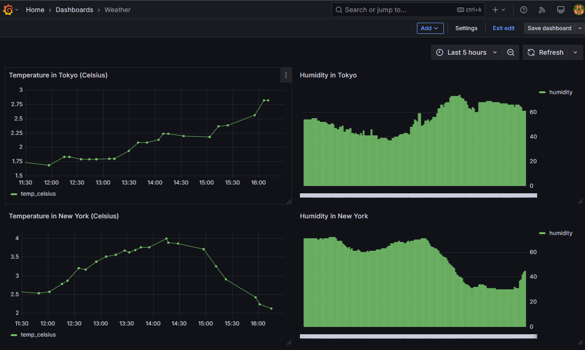

# Real-Time Weather Data Pipeline

An end-to-end streaming data pipeline that ingests live weather data, streams it through Kafka, orchestrates processing with Airflow, persists to PostgreSQL, and visualizes in real time via Grafana — fully containerized with Docker Compose.

**Stack:** Python · Apache Kafka · Apache Airflow · PostgreSQL · Grafana · Docker

---

## Architecture

```
OpenWeatherMap API
        │
        ▼
  Python Producer  ──►  Apache Kafka  ──►  Python Consumer
  (fetch every           (ZooKeeper)          │
   10 minutes)                                ▼
                                         PostgreSQL
                                              │
                                              ▼
                                          Grafana
                                    (real-time dashboard)
```

**Data flow:**
1. A Python producer fetches weather data from OpenWeatherMap every 10 minutes for multiple cities
2. Messages are published to a Kafka topic (ZooKeeper-managed)
3. A Python consumer reads from Kafka and writes structured records to PostgreSQL
4. Apache Airflow DAGs orchestrate scheduling, error handling, and retries
5. Grafana connects to PostgreSQL to render live temperature, humidity, and time-series dashboards

---

## Dashboard

Real-time temperature and humidity trends across cities — updated every 10 minutes:



---

## Features

- **Real-time ingestion** — weather data polled every 10 minutes from OpenWeatherMap API
- **Scalable streaming** — Kafka handles message brokering with ZooKeeper coordination
- **Orchestrated processing** — Airflow DAGs manage scheduling, retries, and failure alerting
- **Persistent storage** — structured records in PostgreSQL with efficient time-series querying
- **Live visualization** — Grafana dashboards with color-coded temperature and humidity graphs
- **Production-ready** — fully Dockerized, environment-variable driven, `.gitignore` enforced

---

## Quick start

**Prerequisites:** Docker, Docker Compose, Python 3.8+, OpenWeatherMap API key

```bash
# 1. Clone the repo
git clone https://github.com/raghuarunmaram/weather-pipeline
cd weather-pipeline

# 2. Add your API key
echo "OPENWEATHER_API_KEY=your_key_here" > .env

# 3. Start all services
docker-compose up -d

# 4. Access Airflow UI
open http://localhost:8080   # default: airflow / airflow

# 5. Access Grafana dashboard
open http://localhost:3000   # default: admin / admin
```

---

## Project structure

```
weather-pipeline/
├── dags/               # Airflow DAGs for orchestration
├── scripts/            # Kafka producer & consumer scripts
├── assets/             # Dashboard screenshots
├── docker-compose.yml  # Full stack definition
├── requirements.txt    # Python dependencies
└── .gitignore
```

---

## Tech stack

| Layer | Technology |
|---|---|
| Data source | OpenWeatherMap REST API |
| Streaming | Apache Kafka + ZooKeeper |
| Orchestration | Apache Airflow |
| Storage | PostgreSQL |
| Visualization | Grafana |
| Language | Python 3.8+ |
| Infrastructure | Docker + Docker Compose |

---

## About the author

**Raghu Arun Maram** — Senior Data Engineer @ Meta, Ex-AWS

I build large-scale data pipelines and AI-native agentic systems. This project reflects the same patterns I use in production: event-driven ingestion, orchestrated processing, and observability-first design.

[LinkedIn](https://www.linkedin.com/in/raghuarunmaram/) · [GitHub](https://github.com/raghuarunmaram) · raghuarun34@gmail.com
